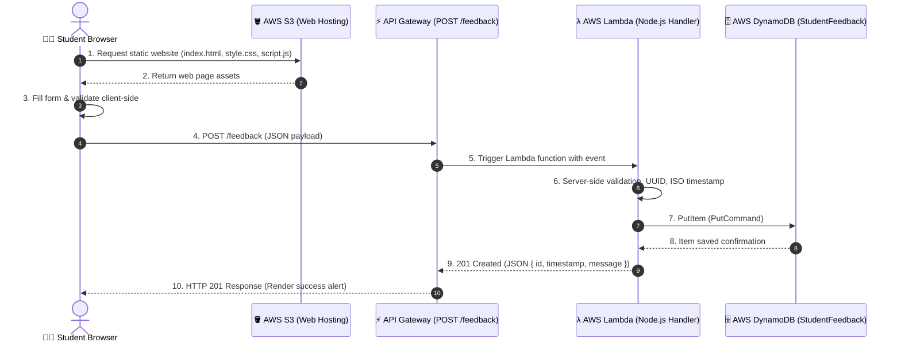

# 🎓 Student Feedback System (AWS Serverless)

A modern, responsive, serverless **Student Feedback System** built for college mini projects. It allows students to submit feedback for courses and teachers through a clean web interface, automatically storing the data in **AWS DynamoDB** via a serverless **AWS Lambda** backend and **Amazon API Gateway**.

---

## 📌 Table of Contents
1. [Project Overview](#-project-overview)
2. [Technologies Used](#-technologies-used)
3. [Architecture Overview](#-architecture-overview)
4. [Project Structure](#-project-structure)
5. [Step-by-Step AWS Setup Guide](#-step-by-step-aws-setup-guide)
   - [Step 1: Create DynamoDB Table](#step-1-create-the-dynamodb-table)
   - [Step 2: Create AWS Lambda Function](#step-2-create-the-aws-lambda-function)
   - [Step 3: Grant IAM Permissions to Lambda](#step-3-grant-iam-permissions-to-lambda)
   - [Step 4: Configure Lambda Environment Variables](#step-4-configure-lambda-environment-variables)
   - [Step 5: Create API Gateway & Connect to Lambda](#step-5-create-api-gateway--connect-to-lambda)
   - [Step 6: Configure CORS in API Gateway](#step-6-configure-cors-in-api-gateway)
   - [Step 7: Configure Frontend with API URL](#step-7-configure-frontend-with-api-url)
6. [Testing Locally Before Cloud Deployment](#-testing-locally-before-cloud-deployment)
7. [Step 8: Deploy Frontend to AWS S3](#step-8-deploy-frontend-to-aws-s3)
8. [Testing the Live Deployed Application](#-testing-the-live-deployed-application)
9. [Common Errors & Troubleshooting](#-common-errors--troubleshooting)
10. [College Viva / Exam Q&A Tips](#-college-viva--exam-qa-tips)

---

## 📖 Project Overview
In educational institutions, gathering structured, timely student feedback on academic curriculum and faculty is essential. This project demonstrates a production-grade **Serverless Cloud Architecture** on Amazon Web Services (AWS) that requires:
- **Zero server management** (no EC2 instances or Apache/Nginx to maintain).
- **Pay-as-you-go / 100% Free Tier compatible** (DynamoDB, Lambda, API Gateway, and S3 are covered within the AWS Free Tier).
- **High scalability & security**.

---

## 🛠️ Technologies Used

| Layer | Technology | Purpose |
| :--- | :--- | :--- |
| **Frontend** | HTML5, CSS3, Vanilla JavaScript | Responsive college-style UI with validation and star rating |
| **Hosting** | AWS S3 (Static Website Hosting) | Fast, globally accessible web asset hosting |
| **API Layer** | AWS API Gateway (HTTP/REST API) | Exposes `POST /feedback` endpoint and handles routing & CORS |
| **Compute** | AWS Lambda (Node.js 20.x / 18.x) | Executes serverless business logic, validation, and UUID generation |
| **Database** | AWS DynamoDB (NoSQL) | Serverless, highly scalable key-value database storing feedback |

---

## 🏛️ Architecture Overview

### Data Flow Diagram



---

## 📂 Project Structure

```text
student-feedback/
├── frontend/
│   ├── index.html       # Clean college feedback UI (form, stars, alerts)
│   ├── style.css        # Pure CSS styling (responsive, modern college theme)
│   └── script.js        # Client validation, star rating, fetch POST logic
│
├── backend/
│   ├── lambda.js        # AWS Lambda handler (Node.js AWS SDK v3)
│   └── package.json     # Node.js dependencies configuration
│
└── README.md            # Complete deployment guide & viva answers
```

---

## 🚀 Step-by-Step AWS Setup Guide

> [!NOTE]
> Ensure you have an active AWS Account. Everything in this project operates well within the **AWS Free Tier**.

---

### Step 1: Create the DynamoDB Table
1. Open the [AWS Management Console](https://console.aws.amazon.com/).
2. In the top search bar, type **DynamoDB** and select it.
3. Click **Create table**.
4. Configure the following settings:
   - **Table name**: `StudentFeedback` *(case-sensitive)*
   - **Partition key**: `id`
   - **Data type**: `String`
   - **Sort key**: *(Leave empty)*
   - **Table settings**: Keep **Default settings** (or select **Customized settings** &rarr; **On-Demand** capacity mode to ensure zero cost when idle).
5. Click **Create table**.
6. Wait 10–20 seconds until the table status changes to **Active**.

---

### Step 2: Create the AWS Lambda Function
1. In the AWS Console search bar, type **Lambda** and select it.
2. Click **Create function**.
3. Select **Author from scratch**.
4. Configure the function:
   - **Function name**: `studentFeedbackHandler`
   - **Runtime**: **Node.js 20.x** (or Node.js 18.x)
   - **Architecture**: `x86_64`
5. Click **Create function**.
6. In the **Code source** editor tab:
   - Double-click on `index.mjs`.
   - Delete all existing code.
   - Open [backend/index.mjs](file:///C:/Users/harsh/.gemini/antigravity/scratch/student-feedback/backend/index.mjs) from this repository, copy its entire contents, and paste it into the editor.
   - Verify the Runtime Handler setting shows `index.handler` (default).
7. Click the **Deploy** button (orange button above the code editor) to save changes.

> [!TIP]
> In Node.js 18.x and 20.x Lambda runtimes, `@aws-sdk/client-dynamodb` and `@aws-sdk/lib-dynamodb` come **pre-installed**. You do not need to zip or upload `node_modules`!

---

### Step 3: Grant IAM Permissions to Lambda
By default, Lambda functions cannot write to DynamoDB. You must grant it permission:
1. In the Lambda function console, click the **Configuration** tab.
2. In the left sidebar, click **Permissions**.
3. Under **Execution role**, click on the **Role name** link (e.g., `studentFeedbackHandler-role-xxxx`). This opens the AWS IAM Console in a new tab.
4. On the IAM page:
   - Click **Add permissions** &rarr; **Create inline policy** (or **Attach policies**).
   - Switch to the **JSON** tab.
   - Paste the following policy:

```json
{
  "Version": "2012-10-17",
  "Statement": [
    {
      "Effect": "Allow",
      "Action": [
        "dynamodb:PutItem"
      ],
      "Resource": "arn:aws:dynamodb:*:*:table/StudentFeedback"
    }
  ]
}
```

5. Click **Next**.
6. Name the policy: `LambdaDynamoDBWriteStudentFeedback`.
7. Click **Create policy**.
8. Close the IAM tab and return to Lambda.

---

### Step 4: Configure Lambda Environment Variables
1. Still inside your Lambda function, click the **Configuration** tab.
2. Click **Environment variables** on the left menu.
3. Click **Edit** &rarr; **Add environment variable**:
   - **Key**: `TABLE_NAME`
   - **Value**: `StudentFeedback`
4. Click **Save**.

---

### Step 5: Create API Gateway & Connect to Lambda
You can use an **HTTP API** (fastest and easiest):

1. Search for **API Gateway** in the AWS Console.
2. Under **HTTP API**, click **Build**.
3. In **Create an API**:
   - Click **Add integration**.
   - Select **Lambda**.
   - AWS Region: select your current region (e.g. `us-east-1` or `ap-south-1`).
   - Lambda function: select `studentFeedbackHandler`.
   - **API name**: `StudentFeedbackAPI`.
   - Click **Next**.
4. In **Configure routes**:
   - Method: select **POST**.
   - Resource path: enter `/feedback`.
   - Integration target: verify it points to `studentFeedbackHandler`.
   - Click **Next**.
5. In **Define stages**:
   - Keep stage name as `$default` with Auto-deploy enabled.
   - Click **Next**.
6. Review and click **Create**.

---

### Step 6: Configure CORS in API Gateway
For the frontend browser to communicate with the API without cross-origin errors:

1. Inside your new API Gateway (`StudentFeedbackAPI`), look at the left sidebar menu under **Develop**.
2. Click **CORS**.
3. Click **Configure** on the right side.
4. Fill in the following CORS settings:
   - **Access-Control-Allow-Origin**: `*` *(or your S3 website URL once created)*
   - **Access-Control-Allow-Headers**: `content-type, authorization`
   - **Access-Control-Allow-Methods**: `POST, OPTIONS`
5. Click **Save**.
6. Note down the **Invoke URL** shown on the API details page (e.g., `https://abcdef123.execute-api.us-east-1.amazonaws.com`).
   Your full endpoint is:
   ```text
   https://<your-api-id>.execute-api.<region>.amazonaws.com/feedback
   ```

---

### Step 7: Configure Frontend with API URL
1. Open the [frontend/script.js](file:///C:/Users/harsh/.gemini/antigravity/scratch/student-feedback/frontend/script.js) file in your code editor.
2. Locate line 14:
   ```javascript
   const API_URL = "YOUR_API_GATEWAY_URL";
   ```
3. Replace `"YOUR_API_GATEWAY_URL"` with your actual endpoint URL:
   ```javascript
   const API_URL = "https://abcdef123.execute-api.us-east-1.amazonaws.com/feedback";
   ```
4. Save the file.

---

## 💻 Testing Locally Before Cloud Deployment

You can test the frontend locally on your computer before uploading to S3:

### Option A: Using Python Simple HTTP Server
Open your terminal inside the `student-feedback/frontend` directory:
```bash
cd frontend
python -m http.server 8000
```
Open your browser at: `http://localhost:8000`

### Option B: Using Node.js `npx serve`
```bash
cd frontend
npx serve .
```

### Option C: VS Code Live Server Extension
Right-click [frontend/index.html](file:///C:/Users/harsh/.gemini/antigravity/scratch/student-feedback/frontend/index.html) &rarr; Select **Open with Live Server**.

### Option D: Direct Browser Open
Simply double-click `index.html` to open it in Chrome, Edge, or Firefox.

> [!NOTE]
> Even if you haven't deployed your AWS backend yet, submitting the form will trigger a **Demo Mode** alert showing that client-side validation succeeded and displaying the JSON payload that would be sent to AWS.

---

## 🌐 Step 8: Deploy Frontend to AWS S3

Now make your website live on the internet using Amazon S3 Static Website Hosting.

### 1. Create S3 Bucket
1. Search for **S3** in the AWS Console.
2. Click **Create bucket**.
3. Configure bucket settings:
   - **Bucket name**: `student-feedback-app-<your-roll-no>` *(Bucket names must be globally unique across all of AWS)*.
   - **AWS Region**: Choose the same region as your Lambda and DynamoDB.
   - Under **Block Public Access settings for this bucket**:
     - **Uncheck** "Block *all* public access".
     - Check the box: *"I acknowledge that the current settings might result in this bucket and the objects within it becoming public."*
4. Click **Create bucket**.

---

### 2. Enable Static Website Hosting
1. Click on your newly created bucket name.
2. Go to the **Properties** tab.
3. Scroll all the way down to **Static website hosting**.
4. Click **Edit**.
5. Select **Enable**.
6. Hosting type: **Host a static website**.
7. In **Index document**, enter: `index.html`.
8. In **Error document**, enter: `index.html`.
9. Click **Save changes**.
10. Note the **Bucket website endpoint URL** shown at the bottom of the Properties tab (e.g., `http://student-feedback-app-123.s3-website-us-east-1.amazonaws.com`).

---

### 3. Add Public Read Bucket Policy
1. Go to the **Permissions** tab of your bucket.
2. Scroll to **Bucket policy** and click **Edit**.
3. Paste the following policy (replace `YOUR_BUCKET_NAME` with your actual bucket name):

```json
{
  "Version": "2012-10-17",
  "Statement": [
    {
      "Sid": "PublicReadGetObject",
      "Effect": "Allow",
      "Principal": "*",
      "Action": "s3:GetObject",
      "Resource": "arn:aws:s3:::YOUR_BUCKET_NAME/*"
    }
  ]
}
```
4. Click **Save changes**.

---

### 4. Upload Frontend Files
1. Go to the **Objects** tab of your bucket.
2. Click **Upload** &rarr; **Add files**.
3. Select the 3 files from your local `frontend` folder:
   - `index.html`
   - `style.css`
   - `script.js` *(Make sure `API_URL` is updated!)*
4. Click **Upload**.

---

## 🧪 Testing the Live Deployed Application

1. Open your **S3 Bucket website endpoint URL** in your browser.
2. Fill out the form:
   - **Student Full Name**: `Aarav Sharma`
   - **USN / Roll Number**: `1MS21CS045`
   - **Subject / Course**: `Cloud Computing & DevOps`
   - **Teacher / Faculty Name**: `Dr. Rajesh Sharma`
   - **Rating**: Click `5` stars
   - **Feedback**: `Excellent explanations of AWS Serverless concepts and hands-on lab sessions!`
3. Click **Submit Feedback**.
4. You should see a green success alert displaying:
   - `Feedback Submitted Successfully!`
   - A generated Reference ID (UUID) and timestamp.
5. **Verify in DynamoDB**:
   - Go to the AWS DynamoDB Console &rarr; **Tables** &rarr; `StudentFeedback`.
   - Click **Explore table items**.
   - You will see your newly submitted feedback record stored in the table!

---

## 🛠️ Common Errors & Troubleshooting

### 1. `CORS error` or `NetworkError when attempting to fetch resource`
- **Cause**: Browser blocked the request because API Gateway or Lambda didn't return proper CORS headers.
- **Fix**:
  - In API Gateway &rarr; CORS &rarr; Ensure `Access-Control-Allow-Origin: *` and `Methods: POST, OPTIONS` are saved.
  - Ensure your Lambda function returns the `Access-Control-Allow-Origin: "*"` header in all response objects (included in our `backend/lambda.js`).

### 2. `HTTP 500: Failed to save feedback to DynamoDB`
- **Cause**: Lambda lacks permissions to write to DynamoDB or the table name doesn't match.
- **Fix**:
  - Check the Lambda execution role in IAM &rarr; Ensure `dynamodb:PutItem` permission is attached.
  - Verify that the DynamoDB table is named exactly `StudentFeedback` (capital S, capital F).
  - Open **CloudWatch Logs** &rarr; Log groups &rarr; `/aws/lambda/studentFeedbackHandler` to see the exact error stack trace.

### 3. `HTTP 403 Forbidden` on S3 Website URL
- **Cause**: The S3 bucket is blocking public access or the bucket policy is missing.
- **Fix**:
  - In S3 &rarr; Bucket &rarr; Permissions &rarr; Ensure "Block public access" is OFF.
  - Ensure the bucket policy has `"s3:GetObject"` on `"arn:aws:s3:::YOUR_BUCKET_NAME/*"`.

### 4. `HTTP 404 Not Found` when submitting form
- **Cause**: API Gateway route is incorrect.
- **Fix**: Make sure you appended `/feedback` to the API Gateway Invoke URL in `script.js`.

---

## 🎓 College Viva / Exam Q&A Tips

Here are common questions external examiners or professors ask during project evaluation:

**Q1: What is Serverless Computing?**
> *Answer*: Serverless is a cloud computing model where cloud providers automatically manage server provisioning, scaling, and maintenance. Developers only write code (like AWS Lambda functions), and charges are incurred only when the code actually runs.

**Q2: Why did you choose DynamoDB over MySQL/PostgreSQL?**
> *Answer*: DynamoDB is a fully managed, serverless NoSQL database. It scales automatically, offers single-digit millisecond latency, has zero idle maintenance cost, and easily stores dynamic student feedback without managing database connection pools.

**Q3: What is the role of API Gateway?**
> *Answer*: API Gateway acts as the secure front door for Lambda. It accepts HTTP requests from the browser, validates paths, handles CORS preflight checks, and routes the request to our Lambda function.

**Q4: How is CORS handled in this architecture?**
> *Answer*: Cross-Origin Resource Sharing (CORS) is handled in two places:
> 1. At API Gateway by enabling CORS on the route.
> 2. In the Lambda response by returning `Access-Control-Allow-Origin: *` and `Access-Control-Allow-Methods: OPTIONS,POST` headers.

**Q5: What is the partition key in your DynamoDB table and why?**
> *Answer*: The partition key is `id` (a UUID v4). Using a UUID guarantees high cardinality and even distribution across DynamoDB physical partitions, preventing hot partition bottlenecks.
